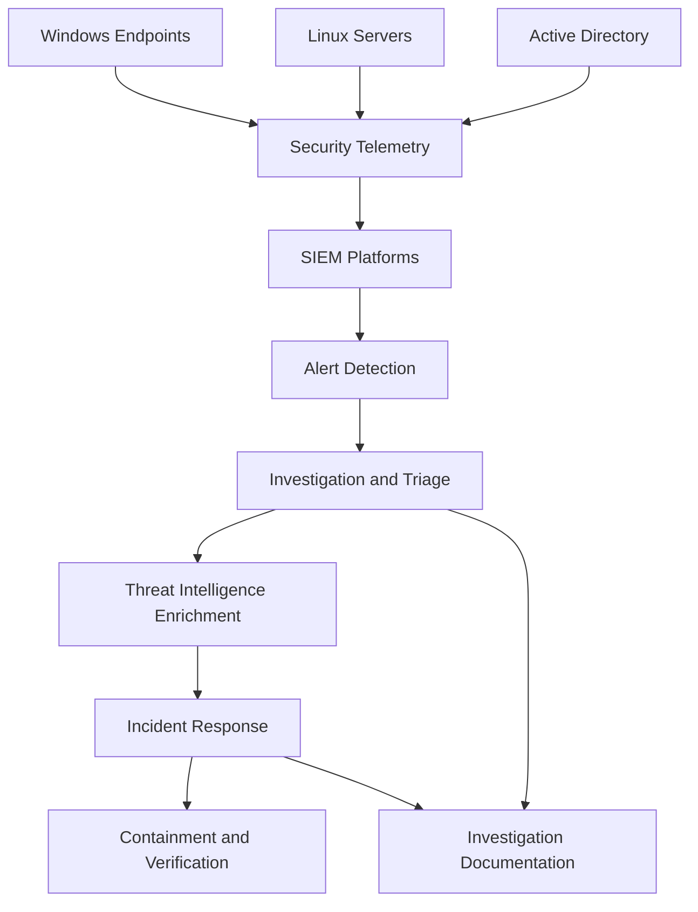

# SOC Analyst Portfolio Project: Triton Health Services

> **Portfolio project.** Triton Health Services is a fictional healthcare organization created for this SOC simulation. All systems, users, security events and findings are illustrative and based on controlled lab activities.

## Overview

An end-to-end Security Operations Center (SOC) simulation for **Triton Health Services**, a fictional healthcare organization operating an on-premises Windows and Linux environment with Active Directory, endpoints, servers and centralized security monitoring.

The project demonstrates how a SOC Analyst monitors security telemetry, detects suspicious activity, investigates alerts, correlates events, enriches indicators of compromise and coordinates incident response.

**Why I built this:** SOC Analyst job descriptions repeatedly require practical experience in alert monitoring, triage, investigation, threat detection and incident response. This project demonstrates those capabilities through hands-on implementation rather than theoretical descriptions. See [how this project maps to real job requirements](docs/06-soc-job-requirements-map.md).

## Key Findings

| Severity | Count | Headline |
|---|---:|---|
| 🔴 Critical | 1 | Mythic command-and-control activity detected through endpoint telemetry |
| 🟠 High | 3 | RDP brute-force activity, SSH brute-force activity and suspicious endpoint execution |
| 🟡 Medium | 2 | Unauthorized file modifications and suspicious account activity |
| 🟢 Low | Not established | No low-severity findings formally documented |

**Top priority:** Investigate and contain confirmed malicious activity, prioritizing command-and-control behaviour and repeated authentication attacks.

## Architecture

Full architecture and telemetry flow: [docs/03-soc-architecture-and-telemetry-flow.md](docs/03-soc-architecture-and-telemetry-flow.md)

## Project Structure

| File | What it shows |
|---|---|
| [01 SOC Environment and Scope](docs/01-soc-environment-and-scope.md) | Organization context, lab environment, systems and monitoring scope |
| [02 Alert Triage and Investigation Methodology](docs/02-alert-triage-and-investigation-methodology.md) | How alerts are reviewed, prioritized, investigated and documented |
| [03 SOC Architecture and Telemetry Flow](docs/03-soc-architecture-and-telemetry-flow.md) | Monitoring architecture, log sources and telemetry flow |
| [04 Incident Response and Remediation](docs/04-incident-response-and-remediation.md) | Investigation, containment, remediation and verification activities |
| [05 SOC Executive Summary](docs/05-soc-executive-summary.md) | Key findings, operational outcomes and areas requiring attention |
| [06 SOC Job Requirements Map](docs/06-soc-job-requirements-map.md) | How project evidence maps to real SOC Analyst job requirements |
| [Investigation Register](investigations/investigation-register.md) | Documented investigations, findings, evidence and response actions |

## Frameworks and Methodologies

- **MITRE ATT&CK:** Mapping observed adversary behaviour to tactics and techniques.
- **Incident Response:** Investigation, containment, remediation and recovery activities.
- **Security Monitoring:** Centralized collection and analysis of Windows and Linux security telemetry.
- **Threat Intelligence:** Enrichment and assessment of indicators of compromise.
- **Detection Engineering:** Developing, testing and refining detection rules.

## What I Learned

- **Alert detection is only the starting point.** Security events need investigation and validation before conclusions can be drawn.
- **Correlating telemetry provides context.** Combining endpoint, authentication and network-related events helps build a clearer picture of suspicious activity.
- **Containment requires verification.** A response action should be followed by checks confirming whether the intended security outcome was achieved.
- **Documentation supports operational decisions.** Recording investigation findings, evidence and response actions makes incidents easier to review and communicate.

## What I'd Improve

- Expand detection coverage for additional attack techniques and suspicious behaviours.
- Integrate additional telemetry sources and improve event correlation.
- Develop further automated response workflows with appropriate analyst approval.
- Improve investigation documentation and evidence-handling procedures.
- Expand monitoring health checks, reporting and shift-handover documentation.

## Tools

Elastic Stack · Splunk Enterprise · Wazuh · Elastic Agent · LimaCharlie · Tines · n8n · Sysmon · Windows Server · Linux · Active Directory · PowerShell · Python · MITRE ATT&CK · AbuseIPDB · VirusTotal · GreyNoise · Markdown · Mermaid