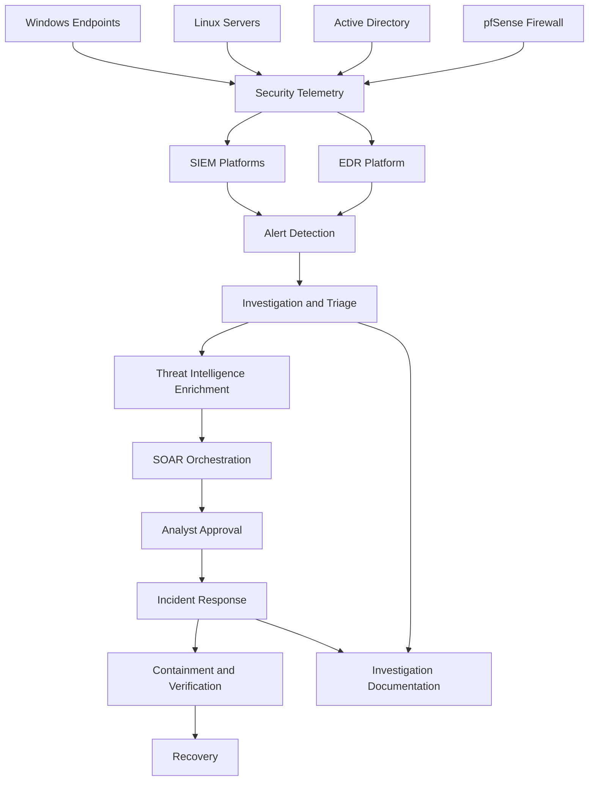

# SOC Analyst Operation: Triton Health Services

> **Portfolio project.** Triton Health Services is a fictional healthcare organization created for this SOC simulation. All systems, users, security events and findings are illustrative and based on controlled lab activities.

## Overview

An end-to-end Security Operations Center (SOC) operation for **Triton Health Services**, a fictional healthcare organization operating an on-premises Windows and Linux environment with Active Directory, endpoints, servers and centralized security monitoring.

This project demonstrates security monitoring, alert triage, endpoint and network investigation, event correlation, threat intelligence enrichment, detection engineering, and incident response, including analyst-approved containment actions, endpoint isolation and recovery.

**Why I built this:** SOC Analyst job descriptions repeatedly require practical experience in security monitoring, alert triage, investigation, threat detection and incident response. I wanted to demonstrate these capabilities through hands-on implementation, not just describe them. See [how this project maps to real job requirements](docs/06-soc-job-requirements-map.md).

## Key Findings

| Severity | Count | Headline |
|---|---:|---|
| 🔴 Critical | 1 | Mythic command-and-control activity and confirmed credential exfiltration from DC1 |
| 🟠 High | 6 | RDP brute-force, logon anomalies, network flow analysis, SIEM investigations, AD authentication weaknesses including `Kerberoasting` and `LaZagne` credential-access activity |
| 🟡 Medium | 4 | Unauthorized file modifications, suspicious account activity, denied proxy request (`TCP_DENIED/403`) and blocked NetBIOS broadcast traffic (UDP/138) |
| 🟢 Low | Not established | No low-severity findings formally documented |

**Top priority:** Investigate and contain confirmed malicious activity, prioritizing command-and-control behaviour and repeated authentication attacks.

**## Architecture**

## Project Structure

| File | What it shows |
|---|---|
| [01 SOC Environment and Scope](docs/01-soc-environment-and-scope.md) | Organization context, lab environment, systems and monitoring scope |
| [02 Alert Triage and Investigation Methodology](docs/02-alert-triage-and-investigation-methodology.md) | How alerts are reviewed, prioritized, investigated and documented |
| [03 SOC Architecture and Telemetry Flow](docs/03-soc-architecture-and-telemetry-flow.md) | Monitoring architecture, log sources and telemetry flow |
| [04 Incident Response and Remediation](docs/04-incident-response-and-remediation.md) | Investigation, containment, remediation and verification activities |
| [05 SOC Executive Summary](docs/05-soc-executive-summary.md) | Key findings, operational outcomes and areas requiring attention |
| [06 SOC Job Requirements Map](docs/06-soc-job-requirements-map.md) | How project evidence maps to real SOC Analyst job requirements |
| [Investigation Register](investigations/investigation-register.md) | Documented investigations, findings, evidence and response actions |

## Frameworks and Methodologies

- **MITRE ATT&CK:** Mapping observed adversary behaviour to tactics and techniques.
- **Incident Response:** Investigation, containment, remediation and recovery activities.
- **Security Monitoring:** Centralized collection and analysis of Windows and Linux security telemetry.
- **Endpoint Detection and Response:** Monitoring endpoint activity, detecting credential-access behaviour and validating containment actions.
- **Threat Intelligence:** Enrichment and assessment of indicators of compromise.
- **Detection Engineering:** Developing, testing and refining detection rules.
- **Security Orchestration and Automation:** Coordinating alert notifications, analyst approval and automated endpoint isolation.
- **Network Security Monitoring:** Firewall traffic filtering, packet analysis and proxy log investigation of web requests, client activity and HTTP activity.

## What I Learned

- **SIEM investigation requires effective event correlation.** Centralising and correlating security telemetry helps identify suspicious patterns and establish incident timelines.
- **EDR investigation requires endpoint-level analysis.** Endpoint telemetry helps identify malicious processes, suspicious behaviour and support containment.
- **Network and packet analysis reveal communication patterns.** Network flows and packet captures help identify suspicious connections and investigate traffic.
- **Firewall and proxy monitoring provide layered network visibility.** Firewall rules enforce traffic controls, while proxy logs provide visibility into web requests and destinations.
- **Authentication and host data provide investigative context.** Logon events, privilege assignments and system activity help establish how suspicious activity affects an environment.
- **Documentation supports operational decisions.** Recording investigation findings, evidence and response actions makes incidents easier to review and communicate.

## What I'd Improve

- Expand detection coverage for additional attack techniques and suspicious behaviours.
- Integrate additional telemetry sources and improve event correlation.
- Develop further automated response workflows with appropriate analyst approval.
- Improve investigation documentation and evidence-handling procedures.
- Expand monitoring health checks, reporting and shift-handover documentation.

## Tools

Splunk · EDR · SOAR · Sysmon · pfSense · Suricata · Active Directory · PowerShell · MITRE ATT&CK · Wireshark · SPL · Linux · Python · Squid Proxy