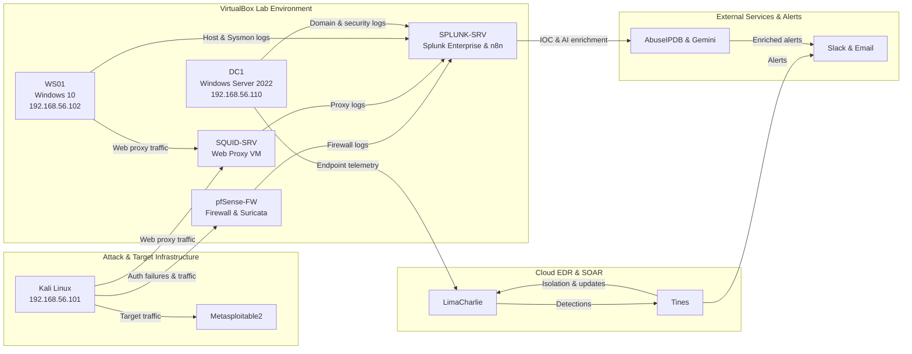

# 03 · SOC Architecture & Telemetry Flow

Understanding **where security events originate, how telemetry moves and where it is analysed** is the foundation of the SOC. Every investigation connects to a point in this architecture.

### Architecture Overview

This diagram depicts a `hybrid` SOC environment built around a local VirtualBox host, where local virtual machines, `Dockerized` microservices and external `SaaS` applications are integrated through the host system's web browser.

The environment uses a VirtualBox `host-only` network, while `NAT` networking provides internet access to the virtual machines. It includes Windows domain infrastructure, a Windows workstation, Splunk SIEM, Kali Linux, and `cloud-hosted` EDR and SOAR platforms. Separate lab environments extend the architecture with pfSense firewall and Suricata, a Squid web proxy, and Metasploitable2 as a vulnerable target system, using dedicated network segments.

The portfolio also incorporates a separate Active Directory lab, `DeleDFIR.local`, used for authentication, identity and credential-security investigations; it is documented as a supporting environment and is not part of the primary `SplunkSOC.local` SOC architecture.

---

### Component Breakdown

#### 1. Attack and Target Infrastructure
- **Kali Linux:** Authorized testing VM used for authentication testing, network scanning and HTTP/HTTPS proxy testing.
- **Metasploitable2 — `192.168.57.10`:** Intentionally vulnerable target used for firewall and network security testing.

#### 2. VirtualBox Lab Environment
- **pfSense-FW — `192.168.56.121` (LAN):** Firewall and gateway providing traffic filtering, routing, network segmentation and Suricata IDS monitoring.
- **SQUID-SRV — `192.168.56.140`:** Squid web proxy providing HTTP/HTTPS access controls, request monitoring and access-log forwarding.
- **DC1 (Windows Server 2022):** Active Directory Domain Controller with LimaCharlie EDR sensor.
- **WS01 (Windows 10):** Domain-joined workstation with Sysmon and Splunk Universal Forwarder.
- **SPLUNK-SRV (Ubuntu Server):** Hosts Splunk Enterprise SIEM and Dockerized n8n automation.

#### 3. Cloud-Hosted EDR and SOAR Integrations
- **LimaCharlie:** Cloud EDR platform for endpoint telemetry collection, detection and isolation.
- **Tines:** Cloud SOAR platform for analyst-approved response workflows, endpoint isolation and notifications.

#### 4. Supporting Active Directory Lab — DeleDFIR.local
- **DC1 (Windows Server 2022) — `192.168.56.110`:** Domain Controller hosting Active Directory and DNS for `DeleDFIR.local`.
- **WS01 (Windows 10) — `192.168.56.102`:** Domain-joined workstation used for authentication and access validation.
- **Kali Linux:** Used for SMB authentication testing, Active Directory enumeration and Kerberoasting analysis.
- **Investigation Scope:** Domain authentication, password-policy assessment, credential exposure and remediation, service-account security and authenticated remote access.

#### 5. Local Automation and Notification Integrations
- **n8n:** Local workflow automation tool coordinating Splunk alert enrichment and AI-assisted analysis.
- **AbuseIPDB:** Threat-intelligence service used to enrich IP indicators.
- **Gemini:** AI service used for alert analysis.
- **Slack:** Receives notifications from n8n and Tines workflows.
- **Email:** Receives detection and response notifications from Tines.

---

### Telemetry & Signal Flow

1. **Traffic Generation:** Kali generates controlled authentication, scanning and proxy-test traffic against the lab targets.

2. **Network Telemetry:** pfSense forwards firewall logs to Splunk over UDP `5514`; SQUID-SRV forwards HTTP/HTTPS access logs to `SPLUNK-SRV`. Suricata monitors network traffic for threats.

3. **Host Telemetry:** WS01 forwards Windows Security, System, Application and Sysmon Operational logs to Splunk Enterprise on `SPLUNK-SRV` over port `9997`.

4. **EDR Response:** DC1 endpoint telemetry flows to LimaCharlie; detections are forwarded to Tines, which obtains analyst approval, initiates isolation through LimaCharlie and receives response status for Slack and email notifications.

5. **SIEM Alert Automation:** Splunk sends alerts to n8n, which submits relevant IP indicators to AbuseIPDB and alert information to Gemini, then sends enriched analysis to Slack.
