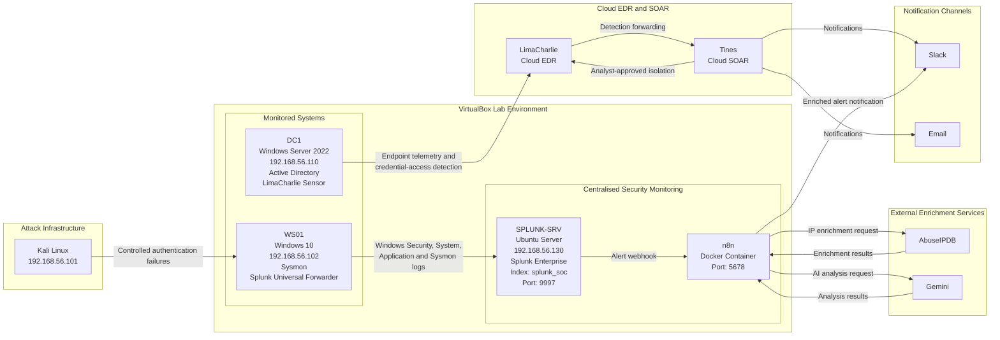

# 03 · SOC Architecture & Telemetry Flow

Understanding **where security events originate, how telemetry moves and where it is analysed** is the foundation of the SOC. Every investigation connects to a point in this architecture.

### Architecture Overview

This diagram depicts a hybrid SOC lab environment built around a local VirtualBox host, where local virtual machines, Dockerized microservices and external SaaS applications are integrated through the host system's web browser.

The environment uses a VirtualBox host-only network (`192.168.56.0/24`), while NAT networking provides internet access to the virtual machines. It contains Windows domain infrastructure, a Windows workstation, a Splunk SIEM server, a Kali Linux attack simulation machine and cloud-hosted EDR and SOAR platforms.

---

### Component Breakdown

#### 1. Attack Infrastructure
* **Kali Linux (Attack Machine) — `192.168.56.101`:** Authorized attack simulation VM generating controlled authentication-failure activity against `WS01`.

#### 2. VirtualBox Lab Environment (Local On-Premises Network)
* **DC1 (Windows Server 2022) — `192.168.56.110`:** Active Directory Domain Controller for the `SplunkSOC.local` domain, with a LimaCharlie EDR sensor installed; generates Windows security events and controlled credential-access telemetry.
* **WS01 (Windows 10) — `192.168.56.102`:** Domain-joined workstation with Sysmon and Splunk Universal Forwarder installed; forwards Windows Security, System, Application and Sysmon Operational logs to Splunk.
* **SPLUNK-SRV (Ubuntu Server) — `192.168.56.130`:** Hosts Splunk Enterprise SIEM using the `splunk_soc` index and receiving port `9997`, alongside Dockerized n8n automation running on port `5678`.

#### 3. Cloud-Hosted EDR and SOAR Integrations
* **LimaCharlie:** Cloud EDR platform receiving endpoint telemetry from the enrolled DC1 sensor and detecting controlled credential-access activity.
* **Tines:** Cloud SOAR platform receiving forwarded LimaCharlie detections, requesting analyst approval for endpoint isolation, sending Slack and email notifications and executing approved isolation actions through LimaCharlie.

#### 4. Local Automation and Notification Integrations
* **n8n (Dockerized Web Interface):** Workflow automation tool running locally on `SPLUNK-SRV`, receiving Splunk alerts through a webhook and coordinating threat-intelligence enrichment and AI-assisted analysis.
* **AbuseIPDB:** Threat-intelligence service used by n8n to enrich IP addresses associated with Splunk alerts.
* **Gemini:** AI service used by n8n for AI-assisted alert analysis.
* **Slack:** Receives notifications from both the n8n automation workflow and Tines SOAR workflows.
* **Email:** Receives notifications from Tines SOAR workflows.

---

### Telemetry & Signal Flow

1. **Attacker Activity:** Kali Linux (`192.168.56.101`) generates controlled authentication-failure activity against `WS01` (`192.168.56.102`).
2. **Authentication:** `WS01` processes the authentication attempts against the domain environment, generating Windows authentication events.
3. **Log Ingestion:** The Splunk Universal Forwarder on `WS01` forwards Windows Security, System, Application and Sysmon Operational logs to Splunk Enterprise on `SPLUNK-SRV` over receiving port `9997`.
4. **EDR Telemetry & Detection:** The LimaCharlie sensor installed on `DC1` sends endpoint telemetry to the LimaCharlie cloud platform, where controlled credential-access activity is detected.
5. **SOAR Detection Forwarding:** LimaCharlie forwards detection events to Tines for SOAR workflow processing.
6. **Analyst-Approved Response:** Tines requests analyst approval before initiating endpoint isolation through LimaCharlie; approved isolation actions are executed through the EDR platform.
7. **SOAR Notifications:** Tines sends alert notifications and response-status updates through Slack and email.
8. **Splunk Alert Automation:** Splunk sends alert data to an n8n webhook hosted on `SPLUNK-SRV`.
9. **Threat Intelligence Enrichment:** n8n sends relevant IP indicators to AbuseIPDB for threat-intelligence enrichment.
10. **AI-Assisted Analysis:** n8n sends alert information for analysis by Gemini.
11. **Automation Notifications:** n8n sends the enriched alert and AI-assisted analysis to Slack.
