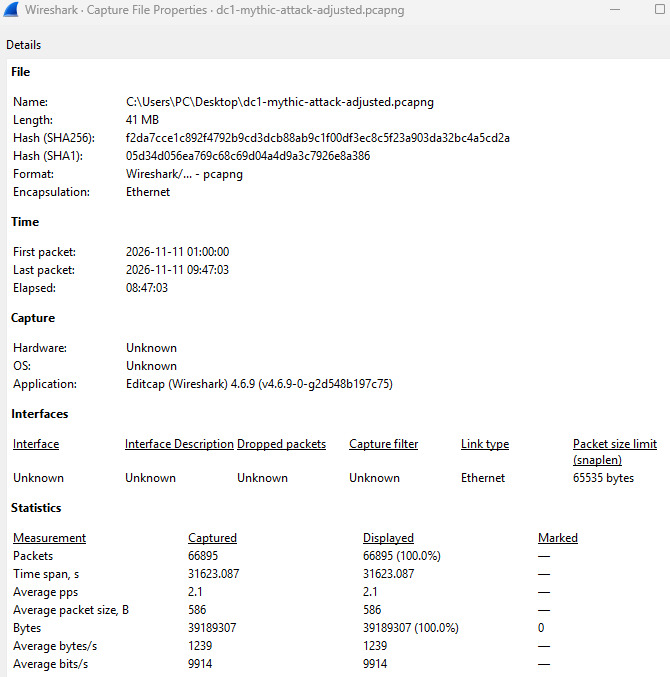
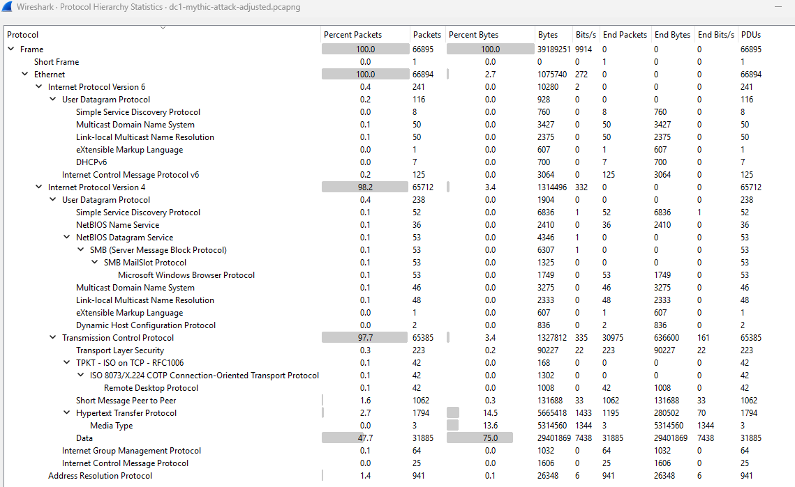
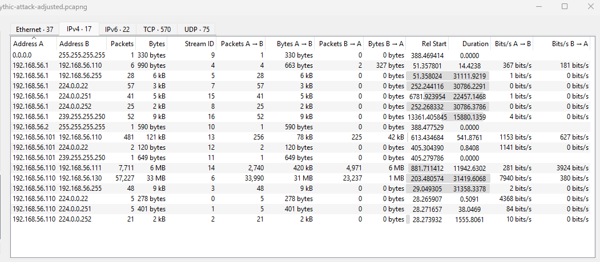
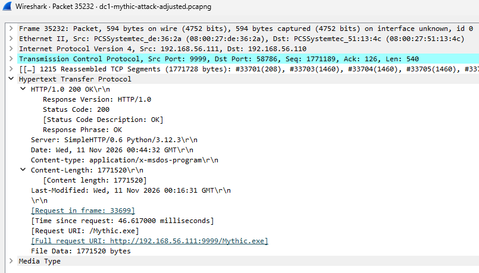

# NETWORK FLOW / PACKET ANALYSIS — INVESTIGATION REPORT

| Field | Details |
|---|---|
| **Report Date** | 2026-11-12 |
| **Reported By** | SOC Analyst |
| **Severity** | High |
| **Status** | Investigation completed; further validation required |
| **Investigation Date** | 2026-11-11 |
| **Capture Window** | 01:00:00–09:47:03 WCAST (UTC+1) |
| **Evidence Source** | Wireshark PCAP |

## 1. Executive Summary

Wireshark analysis identified suspicious internal network activity, including repeated RDP connections from Kali to DC1 and recurring HTTP communication between DC1 and the Mythic C2 server. The HTTP traffic included 596 POST requests carrying Base64-encoded payloads at approximately 10–12-second intervals, consistent with C2 communication.

The suspected multiple-port scanning activity was not confirmed. Further endpoint and authentication log correlation is required to establish execution and user attribution.

## 2. Key Findings

| Finding | Evidence | Assessment |
|---|---|---|
| HTTP C2 communication | 596 POST requests between DC1 and Mythic C2 | High — suspicious |
| RDP activity | 249 packets from Kali to DC1 over TCP/3389 | Suspicious; authentication not confirmed |
| TCP/9997 connection | Completed three-way handshake between DC1 and Splunk | Service responded; port scanning not established |
| Internal traffic | 7,711 packets between DC1 and Mythic C2 | Requires correlation |
| Executable transfers | `apollo-attack.exe` and `Mythic.exe` transferred before capture window | Supporting evidence; timing limitation |
| External communication | No external WAN traffic observed | Limited to simulated internal network |

## 3. Investigation Timeline

All times are WCAST (UTC+1), 11 November 2026.

| Time | Event |
|---|---|
| 01:03:33.258430 | DC1 initiated TCP connection to Splunk on port 9997. |
| 01:18:33 | First observed RDP activity from Kali to DC1. |
| 01:19:14 | Last observed RDP activity. |
| 01:26:21.859325 | First observed HTTP POST `/data` from DC1 to Mythic C2. |
| 02:02:19 | Additional TCP connection established between DC1 and Mythic C2. |
| 03:09:27 | Further TCP connection established between DC1 and Mythic C2. |
| 04:33:27.175956 | Last observed HTTP activity. |
| 09:47:03 | PCAP capture ended. |

## 4. MITRE ATT&CK Mapping

| Technique | Evidence |
|---|---|
| T1071.001 — Web Protocols | Repeated HTTP POST communication with Mythic C2. |
| T1021.001 — Remote Desktop Protocol | RDP connections from Kali to DC1; successful authentication not established. |

## 5. Recommendations

- Investigate DC1 for Mythic agent execution and persistence.
- Correlate RDP activity with Windows authentication logs.
- Validate executable transfers using endpoint evidence and file hashes.
- Restrict RDP access to authorised systems and accounts.
- Improve detection of periodic HTTP communication and suspicious internal connections.

## 6. Indicators of Compromise

| Type | Value |
|---|---|
| Kali | `192.168.56.101` |
| DC1 | `192.168.56.110` |
| Mythic C2 | `192.168.56.111` |
| Splunk | `192.168.56.130` |
| HTTP URI | `/data` |
| Files | `apollo-attack.exe`, `Mythic.exe` |
| Ports | TCP/80, TCP/3389, TCP/9997, TCP/9999 |

## 7. Evidence

Screenshot showing capture start and end timestamps

Protocol breakdown

Conversations dialog highlighting communication volume and packet counts between DC1, the Mythic C2 server, and Splunk.

Detailed packet inspection of a decoded HTTP POST request and response stream between DC1 and the Mythic C2 server.

## Operational Impact
Identified 596 suspected C2 requests and 249 RDP packets involving Kali and DC1, providing quantified evidence to support threat assessment, prioritise investigation and inform incident response; separately documented 57,227 packets of DC1–Splunk traffic to support network activity validation.

**Investigation Limitation:** Multiple-port scanning, successful RDP authentication, endpoint execution and account compromise were not independently established; executable transfers occurred before the PCAP capture window.